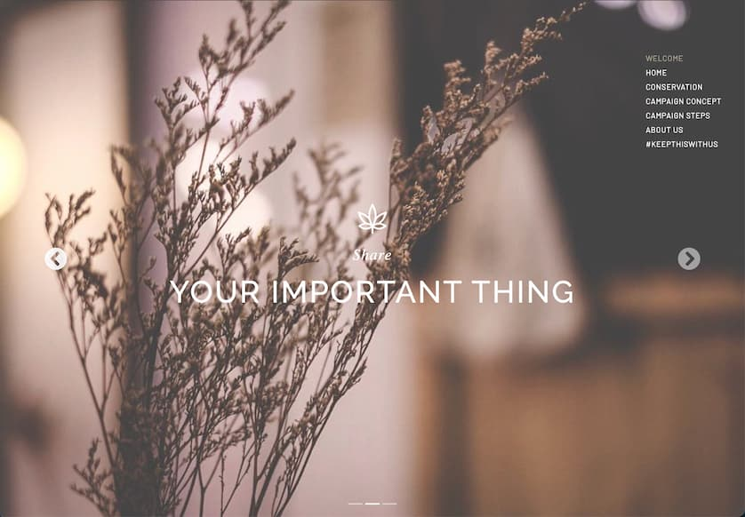

# Keep This With Us

**#KeepThisWithUs** is a conservation awareness campaign website, built as the final project for **ITCS210 Web Programming** at the Faculty of ICT, Mahidol University (MUICT).



## About the course project

The project shows how to build a multi-page static website with:

- **HTML** for page structure
- **CSS** for layout, styling, animations and responsive design
- **Bootstrap** for components such as the Welcome page carousel
- **JavaScript** (with jQuery) for interactions such as the mobile menu, scroll animations and flip cards

## About the campaign

Conservation is not only about wildlife and nature. It is also about protecting culture, tradition and the things people care about. The campaign asks people to:

1. Think about one thing they want to keep
2. Take a photo of it
3. Share it on social media with **#KeepThisWithUs**
4. Write a caption explaining why it matters

By sharing what they want to conserve, people raise awareness of conservation and learn to respect what matters to others.

## Pages

| Page | Content |
|---|---|
| Welcome | Intro carousel |
| Home | Campaign video, quote and the team's "precious things" |
| Conservation | What conservation means and why it matters |
| Campaign Concept | The idea behind the campaign |
| Campaign Steps | How to take part |
| About Us | The team |

## Run locally

Requires [NPM](https://bun.sh).

```bash
npm install
npm run start
```

This opens `html/welcome.html` with live reload.

## Team

- Klinton C.
- Chanikan C.
- Nontapat P.
